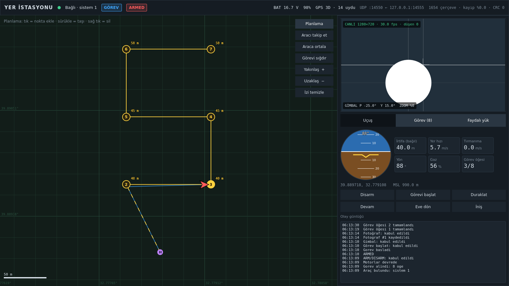
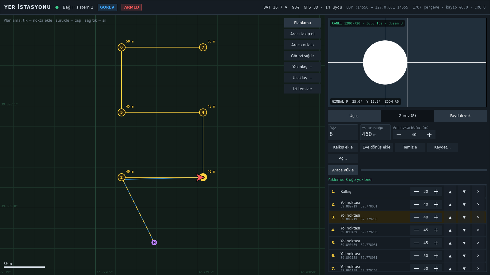
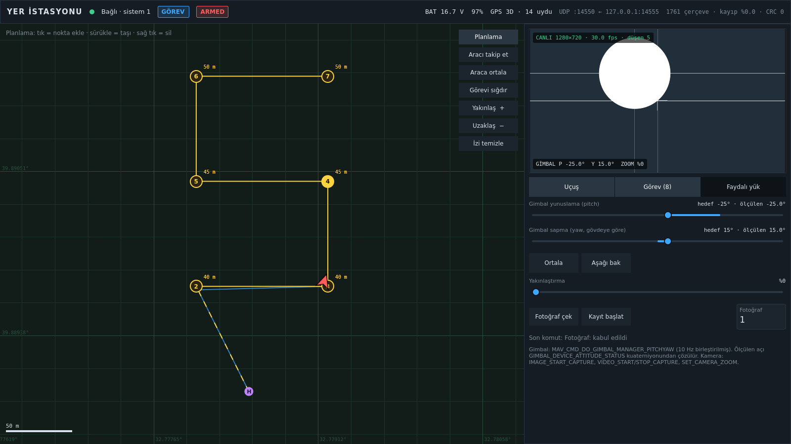

# yer-istasyonu-qt
n[](https://github.com/l4NGEL/yer-istasyonu-qt/actions/workflows/ci.yml)

Linux için Qt 6 / QML ve C++17 ile yazılmış, MAVLink konuşan küçük bir yer kontrol istasyonu.
Bağlı araçtan telemetri alır, harita üzerinde görev planlatıp araca yükler, faydalı yükün
video akışını gösterir ve gimbal/kamera komutlarını gönderir. Gerçek bir araç olmadan
denemek için aynı depoda MAVLink konuşan bir SITL aracı ve sahte bir kamera akışı vardır.



## Neler var

- **Telemetri**: MAVLink v1/v2 UDP üzerinden. Soket ve ayrıştırıcı ayrı bir `QThread`'de
  çalışır; çözülen çerçeveler kuyruklu sinyalle ana iş parçacığına geçer. Bağlantı paneli
  çerçeve sayısını, CRC hatalarını ve dizi numarası boşluklarından paket kaybını gösterir.
- **Görev planlama**: haritaya tıklayarak yol noktası eklenir, nokta sürüklenerek taşınır,
  sağ tıkla silinir; listede sıra ve irtifa düzenlenir. Görev QGroundControl `.plan`
  biçiminin `SimpleItem` alt kümesiyle kaydedilip açılır. Yükleme MAVLink görev
  protokolüyle (`MISSION_COUNT` → `MISSION_REQUEST_INT` → `MISSION_ITEM_INT` →
  `MISSION_ACK`) yapılır, zaman aşımında yeniden gönderir.
- **Video**: GStreamer ile ayrı bir iş parçacığında RTP/H.264 (UDP) ya da RTSP alınır,
  çözülen kare QML'de çizilir. Arayüz yetişemezse eski kare atılır ve sayılır; kuyruk ve
  gecikme birikmez.
- **Faydalı yük**: gimbal yunuslama/sapma (`MAV_CMD_DO_GIMBAL_MANAGER_PITCHYAW`),
  fotoğraf, video kaydı ve yakınlaştırma komutları. Kaydırıcı sürüklenirken komutlar
  10 Hz'e birleştirilir; ölçülen açı `GIMBAL_DEVICE_ATTITUDE_STATUS` kuaterniyonundan çözülür.
- **Komut takibi**: her `COMMAND_LONG` için `COMMAND_ACK` beklenir, yanıt yoksa
  `confirmation` artırılarak yeniden denenir; sonuç olay günlüğüne düşer.
- **SITL**: `gcs-sitl`, basit kinematik bir çok rotorlu araç. Telemetri yayınlar, görev
  alır ve uçar, arm/disarm, eve dönüş, iniş, gimbal ve kamera komutlarına yanıt verir.
  `--loss` ile paketlerin bir kısmını düşürerek bağlantı kaybını taklit eder.

## Mimari

```
            ┌──────────── mavlink-udp iş parçacığı ────────────┐
 UDP ──────▶│ QUdpSocket → mav::Parser → SeqTracker             │
            └───────────────┬──────────────────────────────────┘
                            │ frameReceived(Frame)  [kuyruklu sinyal]
            ┌───────────────▼──────── ana iş parçacığı ────────────────────┐
            │ Vehicle ──▶ QML özellikleri (konum, tutum, pil, kip …)       │
            │ MissionManager (gcs::MissionUploader durum makinesi)         │
            │ PayloadController ─┐                                         │
            │ Vehicle::sendCommand ┴▶ gcs::CommandTracker ─▶ UdpLink::send │
            │ VideoItem ◀── takeFrame() ◀─┐                                │
            └─────────────────────────────┼────────────────────────────────┘
                                          │ LatestMailbox<QImage> + frameReady
            ┌──────────── video-rx iş parçacığı ──────────────┐
 RTP/RTSP ─▶│ GStreamer: depay → h264parse → avdec → appsink  │
            └─────────────────────────────────────────────────┘
```

Depo üç katmana ayrılır:

| Dizin | İçerik | Bağımlılık |
|---|---|---|
| `core/` | MAVLink kodlayıcı/ayrıştırıcı, görev protokolünün iki ucu, komut takipçisi, coğrafi hesaplar, `LatestMailbox` | yalnız C++17 standart kütüphane |
| `app/` | `UdpLink`, `Vehicle`, `MissionModel`, `MissionManager`, `PayloadController`, `VideoReceiver`, QML arayüz | Qt 6 (Core, Network, Quick), GStreamer |
| `sitl/` | `SimVehicle` (soketten bağımsız) ve onu UDP'ye bağlayan `gcs-sitl` | `core/`, POSIX soketleri |

Protokol durum makineleri zamanı dışarıdan (`nowMs`) alır ve soket görmez; bu yüzden
kayıp, zaman aşımı ve yeniden deneme senaryoları gerçek saat beklemeden test edilir.

MAVLink mesajları bir kod üreticisiyle değil, kullanılan alt küme için elle yazıldı
(`core/include/gcs/mavlink/messages.hpp`). Doğruluğu bağımsız bir gerçeklemeyle
denetlenir: `tools/gen_golden.py`, pymavlink 2.4.49 ile çerçeveler üretir; testler aynı
alan değerlerinden bayt bayt aynı çıktının üretildiğini ve pymavlink çerçevelerinin
doğru çözüldüğünü doğrular (v2'deki sondaki sıfır kırpması dahil).

## Derleme

Ubuntu 24.04 paketleriyle (Qt 6.4, GStreamer 1.24) ya da depodaki `Dockerfile` ile:

```bash
docker build -t yer-istasyonu-qt:dev .
docker run --rm -v "$PWD:/src" yer-istasyonu-qt:dev bash -c \
  "cmake -S . -B build -G Ninja && cmake --build build && ctest --test-dir build --output-on-failure"
```

Doğrudan Ubuntu'da gereken paketler `.github/workflows/ci.yml` içinde listelidir.
CMake seçenekleri: `GCS_BUILD_APP` (Qt arayüzü), `GCS_WITH_GSTREAMER`,
`GCS_SANITIZER=thread|address`, `GCS_WERROR`.

## Çalıştırma

```bash
scripts/demo.sh
```

SITL aracını (`14555 → 14550`), sahte kamera akışını (`udp://5600`) ve yer istasyonunu
birlikte başlatır; örnek görev (`examples/ornek-gorev.plan`) açılır, araç bağlanınca
yüklenir, arm edilir ve başlatılır. Ayrı ayrı:

```bash
build/sitl/gcs-sitl --gcs 127.0.0.1:14550 --listen 14555 --loss 0.1
scripts/sim_video.sh 127.0.0.1 5600
build/app/yer-istasyonu --port 14550 --video udp://5600
```

`--video` için `rtsp://adres/yol` ya da ağ gerektirmeyen `test://` da verilebilir.
`sim_video.sh`, GStreamer Pango eklentisi kuruluysa görüntüye saat ve etiket yazar.
Gerçek bir otopilota (ArduPilot/PX4 SITL) bağlanmak için yalnızca UDP portu yeterlidir;
ancak aşağıdaki sınırlara bakın.

## Testler

`ctest` 65 test çalıştırır: GoogleTest ile 60 çekirdek testi ve 5 QtTest programı.
Ubuntu 24.04 (Qt 6.4.2, GStreamer 1.24, GCC 13) üzerinde `-Werror` ile hepsi geçiyor.
İş parçacığı testlerinin dalgalı olup olmadığını görmek için takım beş kez arka arkaya
koşuldu (`ctest --repeat until-fail:5`), hata çıkmadı. Çekirdek testleri ayrıca
ThreadSanitizer ve AddressSanitizer/UBSan altında da temiz geçiyor (CI'da ayrı işler).

| Test | Neyi doğrular |
|---|---|
| `test_codec`, `test_golden` | CRC, v1/v2 çerçeveleme, sondaki sıfır kırpması, bayt bayt beslemede ayrıştırma, çöp ve sahte STX içinden kurtulma, imzalı çerçeve sınırı, uzantı alanları; pymavlink çerçeveleriyle bayt eşitliği |
| `test_mission` | Görev protokolü: kayıpsız yükleme; iki yönde paket kaybında yeniden gönderimle toparlanma; son ACK kaybı; araç sessizken zaman aşımı; red; iptal |
| `test_command_tracker` | ACK eşleştirme, `confirmation` artırarak yeniden deneme, `IN_PROGRESS` ile süre uzatma, aynı komutun yenisiyle değiştirilmesi |
| `test_mailbox_geo` | `LatestMailbox` iki ve beş iş parçacığıyla: değer kaybı/tekrarı yok, `published = taken + overwritten`, uyarı sayısı alınan kareye eşit; coğrafi hesaplar |
| `test_sim_vehicle` | SITL'e gerçek MAVLink baytlarıyla görev yükleyip uçurma (kalkış → 3 nokta → eve dönüş → iniş → disarm), telemetri hızları, bileşen başına dizi numarası, gimbal ve kamera komutları |
| `tst_udplink` | Soketin worker iş parçacığında, çerçevelerin ana iş parçacığında teslimi; ana iş parçacığı bloke iken 2000 paketlik patlamada sıranın korunması; trafik akarken 15 kez aç/kapat |
| `tst_vehicle_payload` | HEARTBEAT ile bağlanma/kopma, telemetri çözme, komut ACK/zaman aşımı, gimbal komutlarının birleştirilmesi, kuaterniyondan açı |
| `tst_missionmodel` | `QAbstractItemModelTester` altında düzenleme, `.plan` gidiş-dönüş, desteklenmeyen içeriğin açık hata mesajıyla reddi |
| `tst_video` | Boru hattı üretimi ve enjeksiyona karşı girdi denetimi; kod çözmenin ayrı iş parçacığında olması; yavaş tüketicide kare düşürme muhasebesi; tekrarlı başlat/durdur; gerçek RTP/H.264 UDP akışının çözülmesi |
| `tst_sitl_e2e` | `gcs-sitl` ayrı süreçte, gerçek UDP: görev yükle, arm, uç, gimbal, fotoğraf, eve dönüş; her iki yönde %20 paket kaybıyla 15 öğelik görev yükleme |

Ekran görüntüleri `scripts/demo.sh --screenshot docs/ekran_%1.png --screenshot-tabs 0,1,2`
ile ekransız (offscreen, yazılım çizici) alındı:




## Bilinen sınırlar

- Harita çevrimdışı bir metre ızgarasıdır; uydu/sokak karosu yoktur. Ubuntu 24.04'te
  Qt Location paketi bulunmadığı için Canvas üzerinde yerel eşdikdörtgen izdüşümle
  çizilir; birkaç kilometrelik görev alanında yeterlidir, büyük alanlarda değildir.
- Uçuş kipi adları yalnız bu depodaki SITL için çözülür. ArduPilot/PX4'ün `custom_mode`
  tabloları eklenmedi; gerçek otopilotta kip "KİP n" olarak görünür.
- Görev indirme (`MISSION_REQUEST_LIST`), geofence ve rally noktaları yoktur; `.plan`
  okuyucu `ComplexItem` (tarama vb.) içeren dosyaları açıkça reddeder.
- MAVLink v2 imzalı çerçeveler ayrıştırılır ama imza doğrulanmaz.
- `.plan` biçimi QGroundControl'ünkini izler; QGroundControl ile karşılıklı açma
  denenmedi.
- SITL'in uçuş modeli kinematiktir (hız ve tırmanma sınırı, dönüş hızı); rüzgâr,
  dinamik ve sensör gürültüsü yoktur.

## Lisans

MIT
